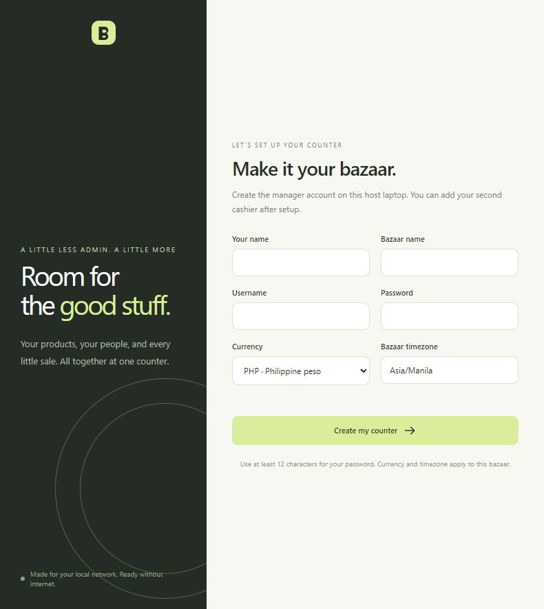

# SQI POS

An offline browser POS for bazaars, with products, inventory, cash sales, acknowledgement receipts, and daily reporting. Two Windows PCs share one SQLite database through a local router. Internet is needed for initial dependency installation; checkout works over the local network.

**Version:** 0.1 · **Server:** Python, Flask, Cheroot · **Database:** SQLite · **Interface:** HTML, CSS, JavaScript

## Features

| Area | Available in version 0.1 |
| --- | --- |
| Products | Unique SKU, optional barcode, description, category, unit, product images, and price history |
| Inventory | Opening stock, stock in/out, physical counts, adjustments, and movement history |
| Checkout | Optional fullscreen with no sidebar, product search/barcode entry with quantity confirmation before adding, saved tickets, cash paid, calculated change, and SQI-branded acknowledgement receipts with company contact details and office hours |
| Duplicate protection | One sale per ticket, replay of repeated payment requests, and warnings for matching recent baskets |
| Accounts | Named managers/cashiers, laptop approval, password confirmation for sensitive changes, and expiring sessions |
| Bazaar days | Day 1, Day 2, etc., cashier shifts, opening/closing cash counts, and cash variance |
| Corrections | Manager-approved returns/voids, live refund calculation from original sale prices, explicit restocking, and cash in/out |
| Reports | Business-date span, day, product, category, cashier, and laptop filters, with Excel-compatible CSV exports |
| Audit and recovery | Append-only audit events, verified database backups, and restore into a new folder |

## Requirements

- **Main PC:** Windows, Python 3.11 or later available as `python`, and a browser.
- **Second PC:** A browser connected to the same router as the main PC.
- **Network:** Private Wi-Fi or Ethernet; LAN mode uses HTTPS.
- **Storage:** Keep the live database on the main PC's internal drive and configure a separate backup destination.

## Install and start on the main PC

Clone the repository, or download and extract its source. In PowerShell, open the project folder and run:

```powershell
git clone https://github.com/ginflorita/sqi-pos.git
cd sqi-pos
.\Install-POS.cmd
.\Start-POS.cmd
```

If you already downloaded or cloned the project, start with `Install-POS.cmd` in its folder. Installation creates a `.venv` environment and downloads the dependencies. After installation, use `Start-POS.cmd` whenever starting the host.

Open **http://localhost:8765** on the main PC. Keep the server running while either cashier is working.

### First-time setup

1. Create your manager account using a password of at least 12 characters.
2. Enter the bazaar name and confirm its currency and timezone.
3. Add categories, products, selling prices, and optional photos.
4. Record opening stock in **Inventory**.
5. Open the first bazaar day and your cashier shift, including opening cash.
6. Add items, review payment, enter cash received, and confirm the sale.

You create the production manager credentials during setup. Setup must be completed on the main PC.

Signed-in managers can add or edit products and photos without entering their password again. A reason is required only when changing an existing selling price. Product changes still record the manager, time, and changed details in the audit trail. Financial, stock, and account approvals retain password confirmation.

Adding stock through **Stock in** or **Opening stock** needs no manual reason: a blank field records `Stock received` or `Opening stock` automatically. Stock-out, physical counts, and signed adjustments still require a reason.



## Connect the second PC

| Device | Responsibility |
| --- | --- |
| Main PC | Runs the server, holds the database, and can also operate a cashier browser |
| Second PC | Opens the host's POS address in its browser and signs in with its own cashier account |

Follow the **[Two-PC setup guide](docs/two-pc-setup.md)** to create and trust the local HTTPS certificate, allow the private-network connection through Windows Firewall, and approve the second laptop.

After certificate setup, stop the existing server and start LAN mode:

```powershell
.\Start-POS.cmd --lan --cert certs/pos.crt --key certs/pos.key
```

The main PC uses `https://localhost:8765`; the second PC uses `https://<MAIN-PC-IP>:8765`. Replace the placeholder with the main PC's actual router-network address. Reserve that address in the router and keep the host awake and connected.

## Daily operation

1. The manager opens the numbered business day.
2. Each cashier signs in and opens a shift with their own drawer's starting cash.
3. Search or scan products, add quantities, review cash payment, and issue the saved sale's receipt.
4. Use **Transactions** to review receipts and process manager-approved corrections.
5. Complete, transfer, or cancel open orders, then count cash and close each shift.
6. Review reports, close the business day, and check that its backup succeeded.

After an uncertain payment response, refresh the same browser to check the existing ticket. It retrieves the original receipt when the sale committed. Use one ticket for each physical customer purchase.

## Backups and restore

Verified online backups run every 15 minutes while the server is running, at day close, and on request. The default folder is `backups/`. Set a separate drive or destination when starting the host:

```powershell
.\Start-POS.cmd --backup-dir E:\BazaarBackups
```

For LAN use, combine `--backup-dir` with the HTTPS flags. Backups include product images. The restore tool verifies a snapshot and restores into a new directory, preserving the original live data. Follow **[Operations](docs/operations.md)** for the full backup, restore, and laptop-recovery procedures.

Live databases, backups, certificate files, environment files, and installed dependencies are excluded from Git.

## Tests

After installing dependencies, run:

```powershell
.\.venv\Scripts\python.exe -m unittest discover -s tests -v
```

The recorded verification has **27 passing tests**, including concurrent checkout, last-unit stock competition, payment retries, catalog permissions, product/stock reason rules, returns, and restore. The browser recovery check also confirmed one sale, one payment, and one stock deduction after a simulated failed response. See the **[verification record](docs/verification.md)**.

## Optional demo

Create sample products and sales in a separate `.demo/` database:

```powershell
.\.venv\Scripts\python.exe tools\demo.py
.\Start-POS.cmd --data-dir .demo --backup-dir .demo/backups --port 8766
```

Open **http://localhost:8766**. Demo credentials are `demo` / `Bazaar-demo-2026!`; they apply only to the sample workspace. A new demo browser still needs laptop approval; the recovery-approval tool is described in Operations. Sample data is kept separate from the production database.

## Current scope

Version 0.1 supports cash payments, whole quantities, one active bazaar, one open ticket per cashier, and separate cash drawers. Discounts and added tax are zero. Fractional quantities, non-cash payments, catalog imports, tax/discount configuration, and additional bazaar creation remain planned.

Before real trading, confirm the bazaar's currency, tax treatment, receipt content, and printer layout, and test both physical PCs, the router, external backups, restore, and power interruption. The host is a single point of availability. Application audit rules do not prevent a host administrator from changing local files.

## Documentation

- [Two-PC setup](docs/two-pc-setup.md)
- [Installation, daily operation, backup, and restore](docs/operations.md)
- [POS plan and business rules](docs/pos-plan.md)
- [Database schema: 28 tables with descriptive primary keys](docs/database-schema.md)
- [Executable SQL schema](pos/schema.sql)
- [Verification and remaining equipment checks](docs/verification.md)
