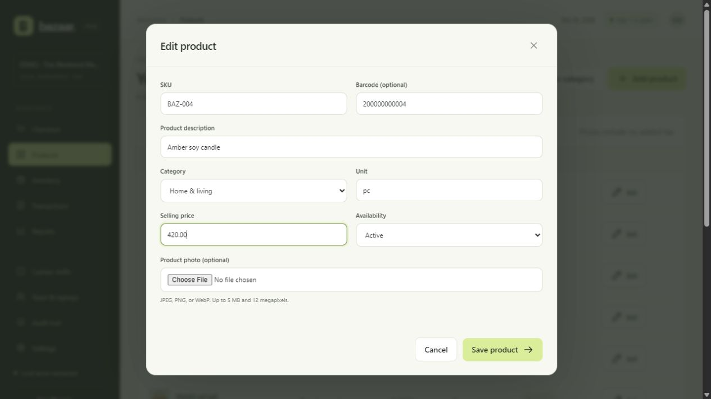
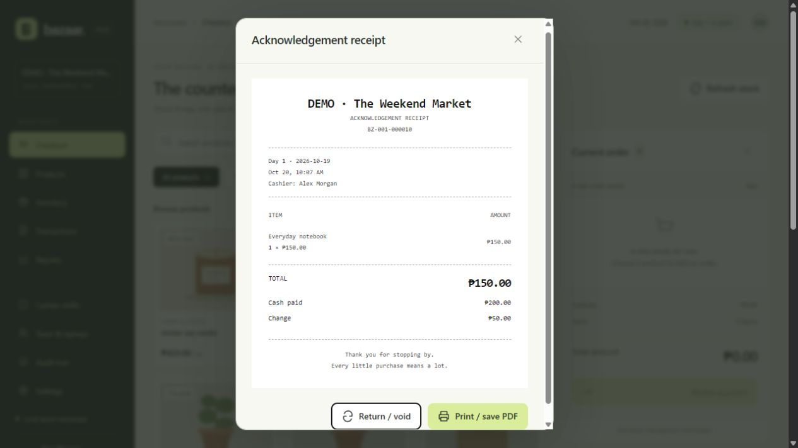

# Verification record

Updated: 2026-10-20 (Asia/Taipei). Release: 0.1. Test/demo data is separate from `data/pos.sqlite3`.

Run `python -m unittest discover -s tests -v`. Integration tests use isolated SQLite files in ignored `.test-runs/` directories and separate cookie sessions.

Latest result: **25 tests passed** in 58.308 seconds. JavaScript syntax validation with `node --check static/app.js` also passed.

## Automated coverage

- Repeated and concurrent checkout requests produce one sale/payment/stock deduction.
- A different request key cannot create another sale for a completed ticket; changed contents cannot reuse a key.
- Two cashiers race for the last unit: one succeeds and stock stays nonnegative.
- Price changes force review; old receipt descriptions/prices remain unchanged.
- Cashier permissions, receipt ownership, CSRF, Origin, and trusted Host checks.
- Stale cart versions and ticket ownership transfer.
- Stock/refund idempotency, return limits, and explicit restocking.
- Day 2 refunds leave Day 1 totals unchanged.
- Failed checkout rolls back financial and inventory records together.
- Historical database rows cannot be edited/deleted; negative stock is rejected.
- Image versions are retained and included in a verified backup.
- Managers create/edit products and upload photos without repeated password confirmation; audit attribution remains automatic.
- Existing price changes require a nonblank reason; rejected changes roll back product details and price together.
- Cashiers and anonymous browsers cannot write the catalog; stock and account actions retain password confirmation.
- Login throttling, disabled-account sessions, and idle sessions despite background polling.
- Receipt reprints create no new sale.
- Report filters and Excel CSV formula protection.
- Near-duplicate baskets require separate-purchase review.
- Restore writes to a new directory, retains live data, and revokes copied sessions.
- Cookie identities remain stable after restore and are isolated between independent databases; HTTPS cookies carry Secure, HttpOnly, and SameSite flags.
- Checkout rejects sessions revoked after the request began, when the write lock is acquired.
- Manager closure of another cashier's shift requires explicit review of its unpaid order and leaves a cancellation/closure audit.

## Browser verification

Checked first-run setup, login, pending-laptop approval, product images/grid, saved cart, cash/change, committed acknowledgement receipt, inventory ledger, and reports at a laptop-size viewport. A separate demo sale with total 420.00, paid 500.00, and change 80.00 produced one receipt and the expected inventory/report changes.

On 2026-10-20, checked the simplified product forms in the separate demo workspace. Creating a product shows no reason or password field. Editing a product shows no password field; changing its selling price reveals the required reason field, and restoring the original price hides and disables that field. No sample price changes were saved during this check.

On 2026-10-20, a dedicated demo server deliberately replaced one successful checkout response with HTTP 503 **after the sale committed**. The browser displayed the failure and retained its payment request. Reloading automatically recovered receipt `BZ-001-000010`: total 150.00, paid 200.00, change 50.00. Database verification found exactly one sale, one payment, and one stock deduction for that ticket. The same session also verified manager closure of the previous demo drawer and opening a replacement-browser shift.

This simulates an uncertain response after commit; it does not replace a physical Wi-Fi-disconnection or power-loss test. The fault-injection helper is `tests/preview_server.py`, restricted to the `.demo/` workspace and loopback. It is not used by `run.py`.

HTTPS startup was verified on loopback with a generated local certificate and certificate validation enabled: the application returned HTTP 200, Secure cookies, and HSTS. No Windows trust or firewall settings were changed. A real LAN connection still requires the target router, certificate trust, and firewall setup described in Operations.

## Remaining equipment checks

Complete a sale from each physical laptop; disconnect/reconnect Laptop 2 during confirmation; check printer failure/reprint; reconcile both cash drawers; verify the external backup drive and a restore; rehearse a power interruption; confirm actual currency, tax treatment, receipt content, and dates.

Fractional quantities, non-cash payments, tax/discount configuration, catalog imports, additional bazaar creation, Windows startup-service installation, and automatic backup deletion are outside version 0.1.
