# Verification record

Updated: 2026-10-20 (Asia/Taipei). Release: 0.1. Test/demo data is separate from `data/pos.sqlite3`.

Run `python -m unittest discover -s tests -v`. Integration tests use isolated SQLite files in ignored `.test-runs/` directories and separate cookie sessions.

Latest result: **27 tests passed** in 63.535 seconds. JavaScript syntax validation with `node --check static/app.js` also passed.

## Automated coverage

- Repeated and concurrent checkout requests produce one sale/payment/stock deduction.
- A different request key cannot create another sale for a completed ticket; changed contents cannot reuse a key.
- Two cashiers race for the last unit: one succeeds and stock stays nonnegative.
- Price changes force review; old receipt descriptions/prices remain unchanged.
- Cashier permissions, receipt ownership, CSRF, Origin, and trusted Host checks.
- Stale cart versions and ticket ownership transfer.
- Stock/refund idempotency, return limits, and explicit restocking.
- Stock-in/opening stock accept omitted or blank reasons with automatic audit text; equivalent retries do not add stock twice and changed reasons cannot reuse a request key. Stock-out, physical counts, and signed adjustments still reject blank reasons.
- Day 2 refunds leave Day 1 totals unchanged.
- Failed checkout rolls back financial and inventory records together.
- Historical database rows cannot be edited/deleted; negative stock is rejected.
- Image versions are retained and included in a verified backup.
- Managers create/edit products and upload photos without repeated password confirmation; audit attribution remains automatic.
- Existing price changes require a nonblank reason; rejected changes roll back product details and price together.
- Cashiers and anonymous browsers cannot write the catalog; stock and account actions retain password confirmation.
- Login throttling, disabled-account sessions, and idle sessions despite background polling.
- Receipt printing accepts omitted/blank reasons with the automatic `Customer copy` audit text and preserves user/laptop/time. Copies create no new sale, payment, or stock deduction; cashier receipt ownership still applies.
- Report filters and Excel CSV formula protection.
- Near-duplicate baskets require separate-purchase review.
- Restore writes to a new directory, retains live data, and revokes copied sessions.
- Cookie identities remain stable after restore and are isolated between independent databases; HTTPS cookies carry Secure, HttpOnly, and SameSite flags.
- Checkout rejects sessions revoked after the request began, when the write lock is acquired.
- Manager closure of another cashier's shift requires explicit review of its unpaid order and leaves a cancellation/closure audit.

## Browser verification

Checked first-run setup, login, pending-laptop approval, product images/grid, saved cart, cash/change, committed acknowledgement receipt, inventory ledger, and reports at a laptop-size viewport. A separate demo sale with total 420.00, paid 500.00, and change 80.00 produced one receipt and the expected inventory/report changes.

On 2026-10-20, enlarged and prioritized **Current order**. At the checked laptop viewport, the panel measured approximately 461 px wide, the total used 36 px text, quantity buttons measured 36 px wide, and **Review payment** measured 56 px high. Adding four different items confirmed that the item list scrolled while payment stayed visible. The larger +/− controls changed one ₱150 item to qty 2 / ₱300 and back to qty 1 / ₱150. These checks used an unpaid ticket in `.demo`; no sale was completed and no production records were changed. The CSS places the order first in a single-column layout at widths up to 1000 px. Whitespace checks passed; this CSS-only update did not rerun the integration suite.

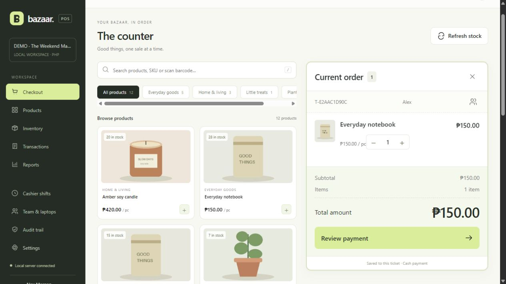

The checkout heading now uses one compact row for **The counter**, its subtitle, and **Refresh stock**. The redundant eyebrow above the title was removed on Checkout. Browser measurement confirmed a 44 px row with all three elements vertically centered. The subtitle truncates when space is limited and is hidden on narrow screens to keep the title and refresh action on one row. JavaScript syntax and whitespace checks passed; this layout check only viewed the existing demo ticket.

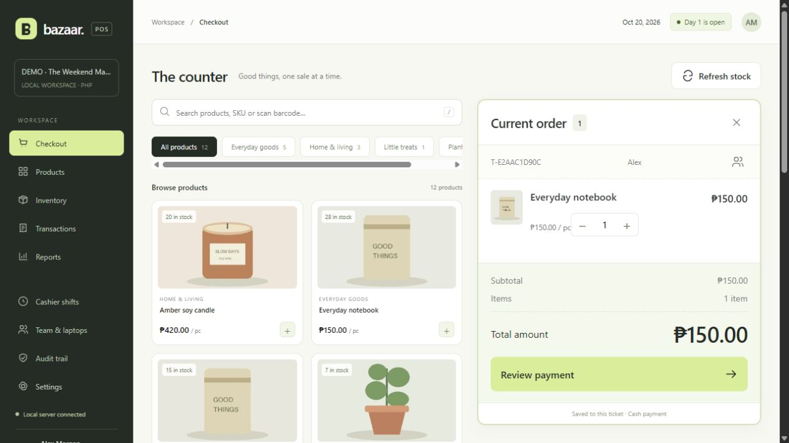

Fullscreen checkout browser checks passed in `.demo`: clicking Checkout from Transactions opened a choice; closing it kept Transactions visible; Standard view retained navigation. Both the checkout Fullscreen button and the choice's Open fullscreen entered the expanded view with sidebar/header hidden and the existing four-unit ₱510 order preserved. Exit fullscreen and Escape restored navigation. Refresh stock retained fullscreen and the order. Browser fullscreen expanded the tested viewport to the display size. JavaScript syntax and whitespace checks passed. This frontend-only update did not submit a sale or stock movement.

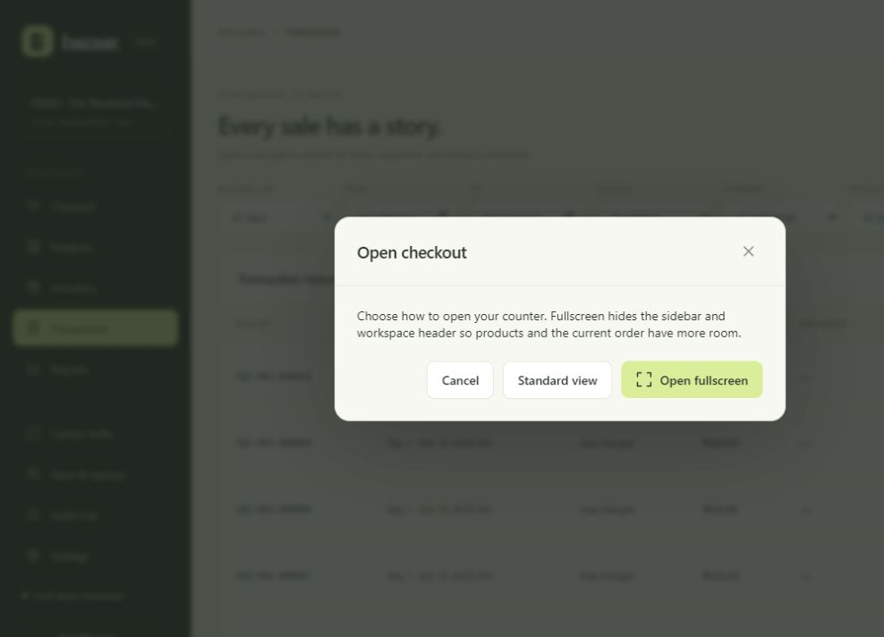

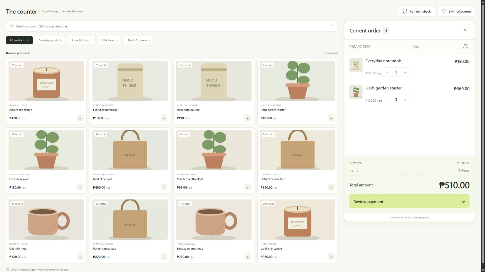

Product selection now opens **Choose quantity** for both product clicks and barcode Enter. Browser checks in `.demo` confirmed that product click/double-click followed by Cancel left ticket version 9 and its 19 update events unchanged. An excessive quantity (8 with 7 available) was blocked. Confirming qty 3 once added exactly 3 units and advanced the ticket to version 10 with 20 update events. Selecting the same barcode then showed 3 already in the order and 4 available; Escape made no additional cart change. The demo retained 10 sales and 184 stock units throughout. The confirmation button briefly ignores the opening double-click, and submissions in progress cannot be submitted again. JavaScript syntax and whitespace checks passed; no production data or sale was changed by these checks.

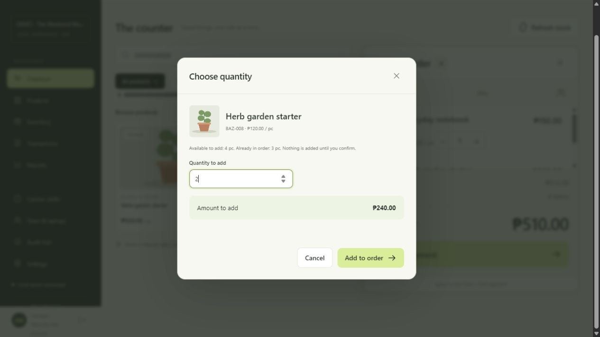

On 2026-10-20, checked the simplified product forms in the separate demo workspace. Creating a product shows no reason or password field. Editing a product shows no password field; changing its selling price reveals the required reason field, and restoring the original price hides and disables that field. No sample price changes were saved during this check.

Also checked the stock movement form: **Stock in** and **Opening stock** label the reason optional and remove its browser-required flag. Switching to **Stock out** restores the required flag and explanation. The form describes the default audit text for each incoming movement. No stock was posted during this browser check.

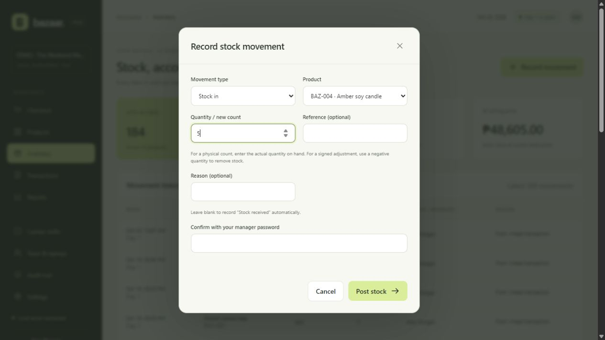

On 2026-10-20, checked SQI receipt branding against saved demo receipt `BZ-001-000010`. The supplied local PNG loaded at its original 5442 × 3064 resolution and displayed at 150 px wide. Verified the company name directly below the logo, full head office address in the footer, and a two-column footer grid: telephone / website on row one and office hours / Monday–Saturday on row two. The dialog opens at the logo. Verified the visible label `Website: https://sqigroup.ph` and its HTTPS destination. The production host served the logo successfully with HTTP 200. JavaScript syntax and whitespace checks passed. These presentation changes did not rerun the 27-test integration suite recorded above.

The logo header and compact company footer are inside the same receipt content used by the existing 80 mm print stylesheet. Also verified the simplified receipt: the extra bazaar/name line under ACKNOWLEDGEMENT RECEIPT is absent, the metadata shows one business date without a Day number or repeated timestamp, and the head office address is left-aligned with the first footer column. The explicitly labeled Cashier line remains in the metadata. These display changes do not alter stored transaction dates or stock. Actual printer/PDF pagination remains an equipment check.

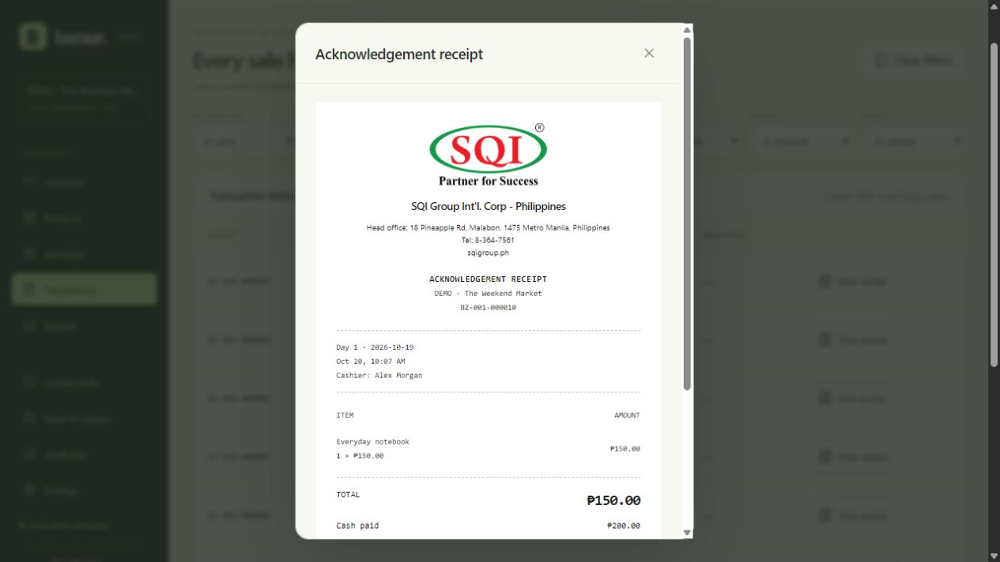

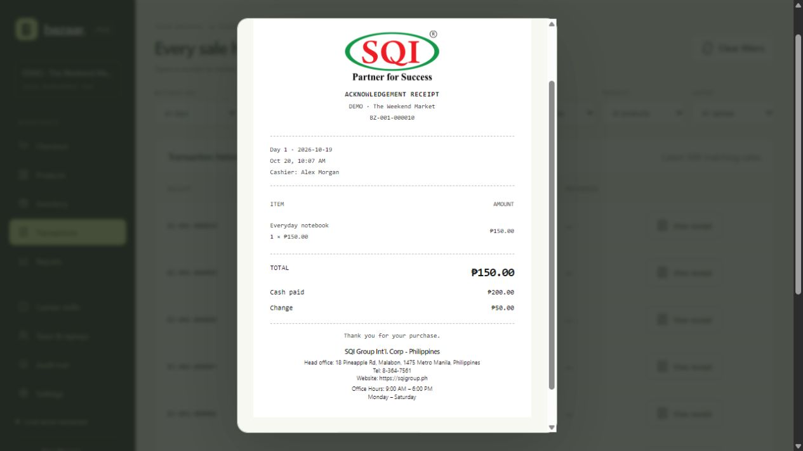

Receipt-prefix verification: the two focused checkout tests (`one_sale_on_double` and `concurrent_duplicate`) passed in 3.127 seconds, including an assertion that a new sale stores `SQI-001-000001`. The demo transaction list and saved receipt `SQI-001-000009` displayed the new prefix for an existing stored `BZ` number. The numeric suffix and historical database records were preserved. JavaScript syntax and whitespace checks passed.

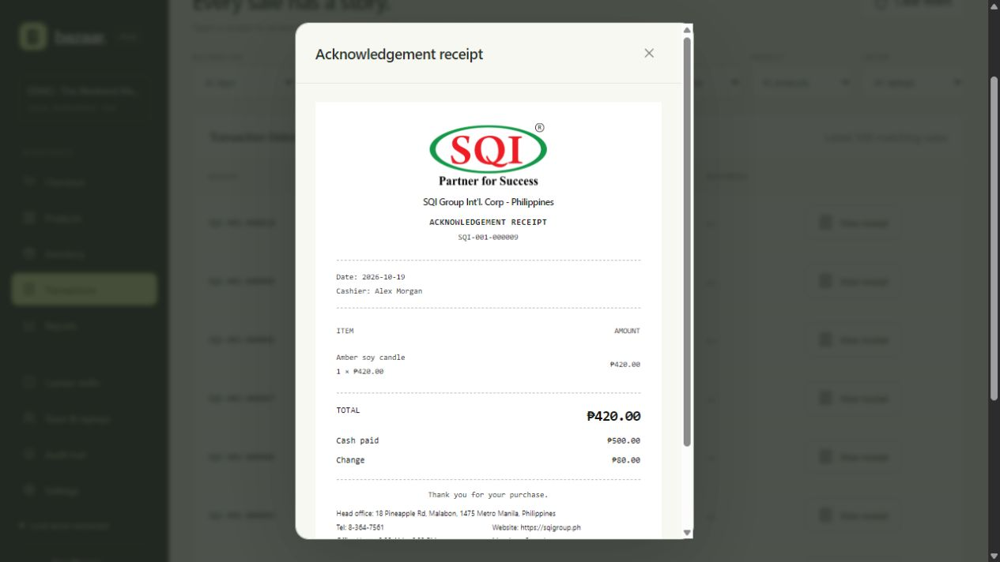

The direct-print update passed two focused regression tests in 2.814 seconds (`python -m unittest discover -s tests -k print -k cashier_roles -v`), plus JavaScript syntax and whitespace checks. In the demo browser, clicking **Print / save PDF** skipped the former reason form and recorded `receipt.print_requested` with `Customer copy` and actor/terminal attribution. The receipt remained visible after the print request. No physical printing was performed; printer output remains an equipment check.

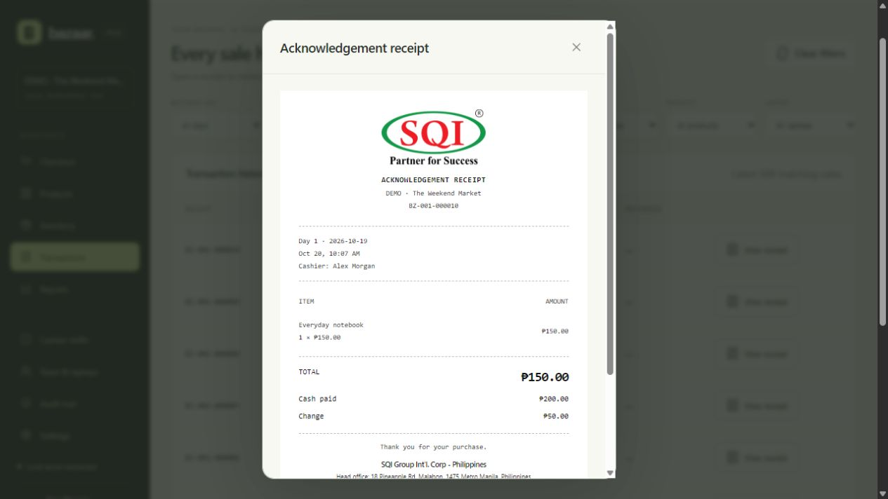

The return form now displays a live refund per item and total using the original sale prices. Browser verification on demo receipt `BZ-001-000010` confirmed return qty 0 → ₱0.00, return qty 1 → ₱150.00, and restock qty 0 or 1 → the same ₱150.00 refund. Return qty 2, exceeding the one remaining item, showed a validation message and no monetary total. JavaScript syntax and whitespace checks passed. No correction was posted during this check; backend refund calculation was unchanged.

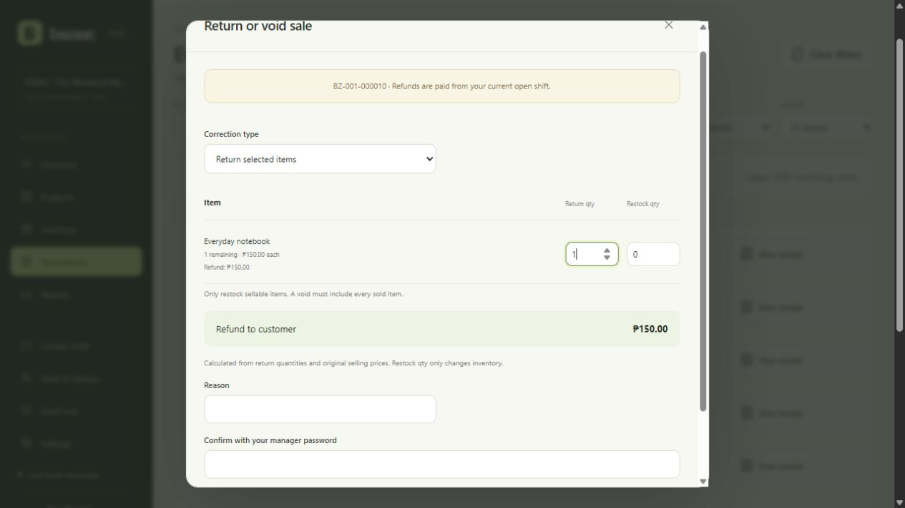

On 2026-10-20, a dedicated demo server deliberately replaced one successful checkout response with HTTP 503 **after the sale committed**. The browser displayed the failure and retained its payment request. Reloading automatically recovered receipt `BZ-001-000010`: total 150.00, paid 200.00, change 50.00. Database verification found exactly one sale, one payment, and one stock deduction for that ticket. The same session also verified manager closure of the previous demo drawer and opening a replacement-browser shift.

This simulates an uncertain response after commit; it does not replace a physical Wi-Fi-disconnection or power-loss test. The fault-injection helper is `tests/preview_server.py`, restricted to the `.demo/` workspace and loopback. It is not used by `run.py`.

HTTPS startup was verified on loopback with a generated local certificate and certificate validation enabled: the application returned HTTP 200, Secure cookies, and HSTS. No Windows trust or firewall settings were changed. A real LAN connection still requires the target router, certificate trust, and firewall setup described in Operations.

## Remaining equipment checks

Complete a sale from each physical laptop; disconnect/reconnect Laptop 2 during confirmation; check printer failure/reprint; reconcile both cash drawers; verify the external backup drive and a restore; rehearse a power interruption; confirm actual currency, tax treatment, receipt content, and dates.

Fractional quantities, non-cash payments, tax/discount configuration, catalog imports, additional bazaar creation, Windows startup-service installation, and automatic backup deletion are outside version 0.1.
